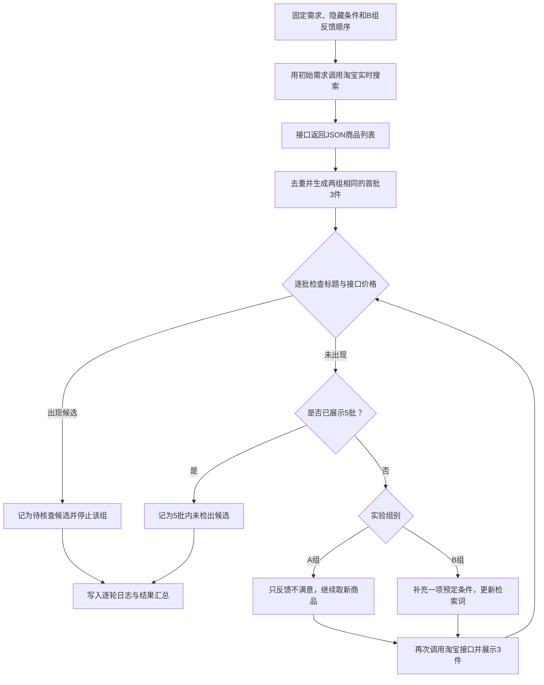

# 充电宝推荐基线实验报告（流程版）

**运行日期：**2026 年 11 月 6 日（北京时间）

## 1. 实验目的与材料

比较两种不由系统主动追问的反馈方式：A 组每轮只回答满意或不满意；B 组在不满意后按预定顺序补充一项要求。实验前固定 50 条不同的充电宝需求，覆盖 10 种使用情境。每条各跑 A、B 一次，首批相同；每批展示 3 件商品，最多 5 批。用户反馈由脚本模拟。

## 2. 数据从哪里来、怎样流动

这里连接的是**淘宝联盟实时搜索接口**，不是预先存好的“淘宝 JSON 库”。实验脚本调用项目已有的 `backend/src/taobao.mjs`；淘宝接口返回 JSON，项目将其整理为商品 ID、标题、接口价格等字段。商品详情里的实际功率、重量和兼容性等尚未自动核实。

核心接入只有一层：`searchTaobao({ query, filters })` 发起请求，返回商品数据。完整的检索、去重、反馈和日志逻辑见 `run_v2.mjs`。

## 3. 本轮结果

| 指标 | A：只反馈满意与否 | B：逐轮补充需求 |
| --- | ---: | ---: |
| 5 批内出现标题与接口价格候选 | 7/50 | 14/50 |
| 首批出现候选 | 3/50 | 3/50 |
| 累计展示批次 | 228 | 205 |
| 累计补充条件 | 0 | 119 |

两组均检出候选 7 条，其中 5 条批次相同、2 条 B 提前 1 批；另有 7 条仅 B 检出。100 次交互共展示 433 批、1299 件次；414 次实时淘宝请求没有接口错误。已保存 1945 条原始事件，校验确认两组首批一致、每批 3 件、同组没有重复标题。

## 4. 一条完整的数据链：第 21 条需求的 B 组

**实验前固定：**公开需求是“想给上学每天带的手机配个充电宝。”隐藏条件为容量 **10000mAh**、USB-C 输出至少 **22.5W**、价格不超过 **80 元**。B 组预定依次补充容量、功率、预算。

| 环节 | 实际发生的事 |
| --- | --- |
| 初始输入与请求 | 脚本把“充电宝 学生”发给淘宝接口，收到 JSON 商品列表；A、B 从中看到相同的首批 3 件。 |
| 第 1 批 | 三件是暖手宝相关商品，接口价格分别为 **59.90、32.22、150.59 元**。按预设检查，没有标题与价格候选。 |
| 用户反馈 | B 组反馈“希望容量是10000mAh。”脚本保存这条反馈，并把“10000毫安”加入下一轮查询。 |
| 第 2 次请求 | 查询变为“充电宝 学生 10000毫安”；淘宝再次返回 JSON，脚本排除已展示商品后展示 3 件。 |
| 第 2 批 | 三件标题均为 vivo 10000 毫安充电宝，分别标称 **22.5W、33W、33W**；接口价格依次为 **79、99、89.30 元**。 |
| 判定与记录 | 第一件标题含容量和功率字样，接口价格 79 元，被标为**待核查候选**；另两件超过预算。B 组在第 2 批停止，商品、检查结果和停止原因写入 `events.jsonl` 与 `summary.json`。 |

同一条需求的 A 组只反馈“不满意”，到第 3 批才出现候选。因此这个例子记录的是 **B 提前 1 批检出候选**。vivo 商品的 USB-C 单口实际输出和对应规格价格尚未核实，不能写成用户已经满意。

## 5. 结论与限制

B 组在候选检出口径下比 A 组多 7 条，方向符合“补充信息有助于检索”的预期；代价是额外 119 次用户信息输入。**7/50 与 14/50 不是满意率。**当前只检查卖家标题与接口价格，无法确认详情规格。第 03 条甚至把“充电宝保护壳”误列为候选，说明还需先做类目过滤和人工复核。

50 条材料是人工组合的便利样本，且都恰有三个隐藏条件；B 组最迟在第 4 批前就能透露全部条件。它测到的是脚本利用逐步补充信息后的检索变化，不能直接说明现有 Wit 智能体或真实用户的满意度。完整逐条材料见 `CARDS_50.md`，逐条结果见 `REPORT_50.md`，原始日志位于 `runs/2026-11-06T08-34-32-644Z/`。
