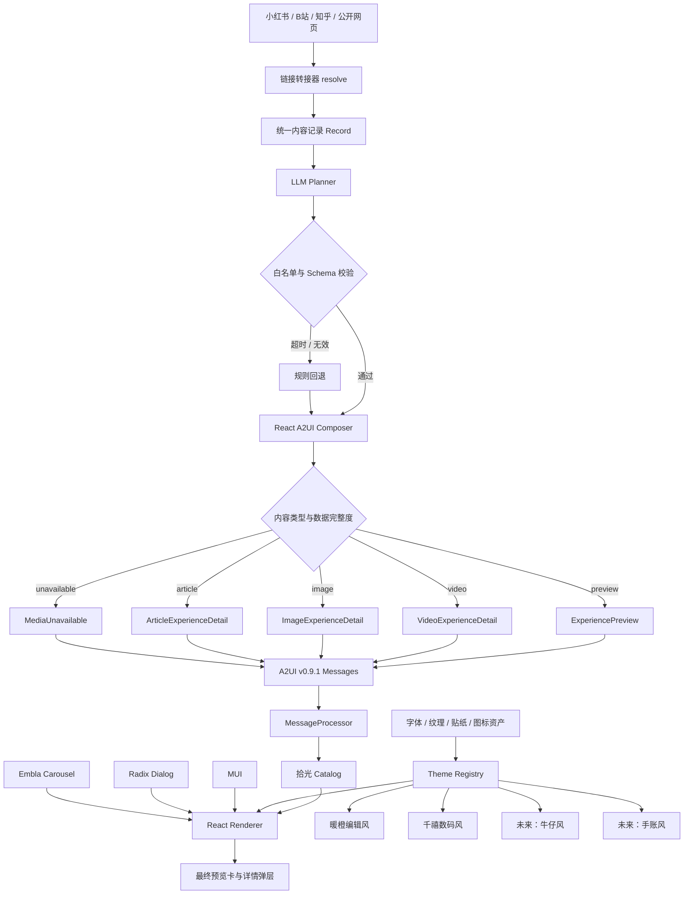
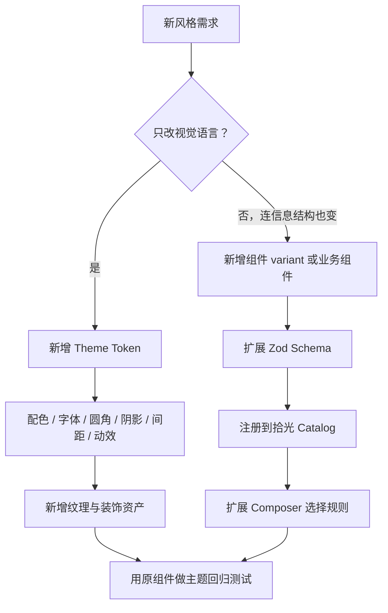

# 拾光 A2UI 主题与组件架构图

## 当前架构

## 风格新增决策

## 主题素材清单

| 类型 | 牛仔风 | 手账风 |
|---|---|---|
| 配色 | 牛仔蓝、革棕、米白、铆钉银 | 米白纸、墨水黑、低饱和贴纸色 |
| 字体 | 粗衬线或 slab serif，正文保持易读 | 手写字用于标题，正文使用清晰黑体 |
| 容器 | 布料边缘、缝线、皮标、金属扣 | 纸张、胶带、便签、撕边、印章 |
| 图标 | 金属线性图标 | 手绘线条图标 |
| 动效 | 沉稳、轻微压入 | 纸张弹出、贴纸观感 |
| 必需资产 | 牛仔纹理、缝线、皮标、扣件 | 纸纹、胶带、贴纸、撕边、印章 |

## 例图要求

- 技术上不强制提供例图，仅用文字也能实现主题。
- 若要稳定地还原特定风格，建议每套主题提供 3–5 张参考图：整体界面、卡片、弹层、材质细节和字体氛围。
- 参考图用来定义设计系统，不需要为每个链接或每次 A2UI 生成重新提供。
- 纹理、贴纸、胶带、布料和金属等可见资产需要使用授权素材或单独生成，不由 A2UI 消息现场绘制。

