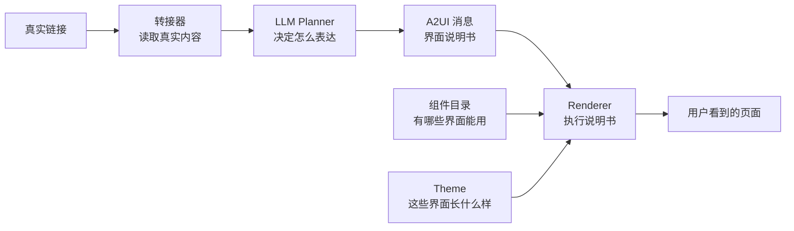

# A2UI 直观理解与修改影响总结

## 先记住一句话

**A2UI 是智能体发给前端的“界面说明书”。**

它不自己读网页，不自己思考，也不自己画出漂亮页面。它把 Planner 的决定以受约束的格式传给 Renderer。



---

## 用同一条充电宝视频理解全部概念

假设系统找到一条 B 站内容：

> 16 款充电宝实测：怎么买不踩坑？

### 1. 转接器：先回答“链接里有什么”

它把不同网站整理成统一数据：

```text
来源：B站
类型：视频
标题：16款充电宝实测
作者：小白测评
封面：真实封面 URL
时长：12:48
摘要：比较快充、发热、容量和重量
```

**修改转接器后，变化的是数据质量。**

- 改善正文抽取：导航、按钮、广告不再混入正文。
- 改善图片筛选：头像、Logo 和宣传图不再冒充内容图。
- 新增来源适配：可以正确读取新的社交平台或电商网站。
- 它不决定最终界面风格。

### 2. LLM Planner：回答“用什么方式表达”

Planner 读到上面的数据，再从允许的组件中选择：

```json
{
  "component": "VideoExperienceDetail",
  "displayTitle": "16款充电宝横向实测",
  "displayBody": "内容比较了快充、发热、容量和重量。",
  "showCover": true,
  "reason": "这是以横向实测为主的视频。"
}
```

**修改 Planner 后，变化的是“选哪种表达”以及“突出什么”。**

- 可以把网页判断为视频、图集或文章。
- 可以在几个合法组件中选最合适的一个。
- 可以精炼展示标题和正文。
- 可以判断是否隐藏无关宣传图。
- 它不能使用组件目录中没有的组件。

### 3. A2UI 消息：回答“把决定怎样告诉前端”

A2UI 消息类似一张结构化订单：

```text
请创建一个详情界面
使用 VideoExperienceDetail
标题使用 /title
封面使用 /cover
正文使用 /body
点击“查看原内容”时执行 open_source
```

**修改 A2UI Schema 后，变化的是智能体和前端之间能交流什么。**

例如，新增 `rating` 字段后，Planner 才能要求组件展示评分。A2UI 本身不决定评分的颜色和位置。

### 4. 组件：回答“内容的骨架和交互是什么”

`VideoExperienceDetail` 规定：

```text
来源 + 作者
↓
视频封面 + 播放标识 + 时长
↓
标题
↓
正文摘要
↓
查看原内容按钮
```

**修改组件后，变化的是布局、信息层级和交互。**

- 把封面从顶部改到左边：组件修改。
- 把标题从两行改为三行：组件或组件 variant 修改。
- 加入图片轮播：组件修改。
- 加入播放、收藏、查看原帖交互：组件修改。
- 把普通视频页换成多商品对比表：需要新组件。

组件可以有默认大小和圆角，但纯视觉数值最好来自 Theme。封面比例、元素顺序、标题最大行数等结构限制由组件负责。

### 5. Theme：回答“同一套骨架长什么样”

Theme 不只控制颜色，它通常包括：

- 主色、背景色、文字色。
- 标题和正文字体、字号与字重。
- 圆角、边框、阴影。
- 间距和信息密度。
- 按钮和输入框的外观。
- 动画速度与缓动方式。
- 纹理、贴纸、胶带、缝线等风格资产。

**修改 Theme 后，内容和结构保持不变，视觉气质改变。**

| 同一个视频组件 | 暖橙编辑风 | 千禧数码风 | 未来的牛仔风 |
|---|---|---|---|
| 颜色 | 米白 + 橙红 | 荧光粉 + 青色 | 牛仔蓝 + 皮革棕 |
| 圆角 | 柔和大圆角 | 夸张大圆角 | 较小圆角 |
| 阴影 | 轻柔模糊阴影 | 硬边偏移阴影 | 压印或皮革阴影 |
| 字体 | 现代无衬线 | 粗重数码感 | Slab Serif + 易读正文 |
| 装饰 | 少量留白 | 高对比发光感 | 牛仔纹理、缝线、铆钉 |

三种 Theme 下，依然是同一个 `VideoExperienceDetail`，封面、标题和按钮的先后顺序不变。

### 6. Catalog：回答“智能体有哪些积木可用”

当前拾光 Catalog 有：

| 组件 | 用途 |
|---|---|
| `ExperiencePreview` | 列表中的通用预览卡 |
| `VideoExperienceDetail` | 视频测评、教程、开箱详情 |
| `ImageExperienceDetail` | 小红书式图集与使用体验 |
| `ArticleExperienceDetail` | 知乎、评测文章、普通网页 |
| `MediaUnavailable` | 内容无法读取时的降级界面 |

**向 Catalog 新增组件后，只是给 Planner 增加了新选项。**

例如新增 `ProductComparisonDetail` 后，还要同时：

1. 定义它需要的数据 Schema。
2. 把它注册进 Catalog。
3. 在 Planner 的可用组件清单中描述什么时候选它。
4. 编写对应 React 组件。

否则 Planner 不知道有这个能力。

### 7. Renderer：回答“谁把说明书真正变成页面”

Renderer 负责：

- 读取 A2UI 消息。
- 从 Catalog 找到对应组件。
- 绑定标题、封面和正文数据。
- 应用 Theme。
- 处理“查看原帖”“打开详情”等事件。
- 把 React 组件真正挂载到浏览器。

**修改 Renderer 通常影响全局执行方式，不应该用来频繁调整单张卡片的设计。**

例如，更换 Renderer 可能改变数据绑定、事件传递和组件注册方式。当前模块使用 React Renderer，具体组件内部再使用 MUI、Radix Dialog 和 Embla Carousel。

---

## 最直观的“修改什么，页面会怎样变”

| 你想看到的变化 | 主要修改哪一层 | 页面会怎样变 |
|---|---|---|
| 暖橙风换成牛仔风 | Theme + 纹理资产 | 颜色、字体、圆角、阴影、缝线装饰变，内容顺序不变 |
| 图文帖改成可左右滑动 | `ImageExperienceDetail` 组件 | 出现图片轮播、箭头和页码 |
| 横评视频要显示 16 款商品的对比表 | 新增 `ProductComparisonDetail` | 信息结构整体改变，需要新 Schema 和新组件 |
| 不同类型横评自动选不同页面 | LLM Planner | 同一来源可因内容语义不同选择不同组件 |
| 普通网页不再出现导航和乱码 | 转接器 + Planner 精炼 | 只保留主题、摘要和有用的商品信息 |
| 点击“查看原内容”没反应 | 组件 Action + Renderer | 按钮事件被正确发出并打开原链接 |
| 智能体需要传递一种新数据 | A2UI Schema + 组件 | 前后端开始认识新字段，组件才能显示它 |

---

## Theme 和组件的分界

用这个判断方法即可：

### 元素的位置、顺序或功能变了

修改 **组件**。

```text
封面从顶部移到左边
标题下面新增参数对比
图片改成可滑动
底部新增购买按钮
```

### 元素还在原位，只是视觉感受变了

修改 **Theme**。

```text
橙色换成牛仔蓝
28px 圆角换成 8px
柔和阴影换成硬边阴影
现代黑体换成 Slab Serif
普通背景加入布料纹理
```

### 系统选错了表达方式

修改 **Planner**。

```text
横评视频不应该用普通视频卡
技术文档不应该用图集卡
无关宣传图应该隐藏
```

### 页面内容本身就是错的

修改 **转接器 / Resolver**。

```text
标题读错
正文混入导航
封面变成 Logo
作者和时长没取到
```

---

## 当前模块的实际分工

| 层 | 当前实现 |
|---|---|
| 转接器 | 小红书、B 站、知乎、YouTube、微博与公开网页的统一解析 |
| Planner | `deepseek-v4-flash`，负责详情组件选择、标题精炼、正文摘要和封面取舍 |
| A2UI | v0.9.1 消息，只允许调用已注册组件 |
| Catalog | 1 个预览组件、3 个详情组件、1 个降级组件 |
| Renderer | React A2UI Renderer |
| 组件基础 | MUI + Radix Dialog + Embla Carousel |
| Theme | 暖橙编辑风、千禧数码风 |

## 最后用一个公式记忆

```text
最终页面
= 真实链接数据
× Planner 的表达决定
× 组件的结构和交互
× Theme 的视觉语言
× Renderer 的执行
```

如果只记三个词：

- **Planner 负责选。**
- **组件负责摆和动。**
- **Theme 负责长相。**

