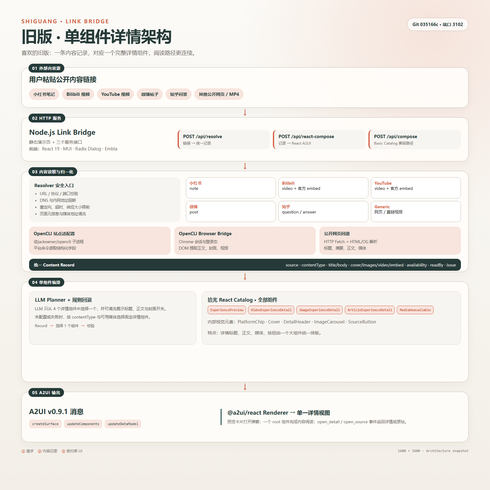
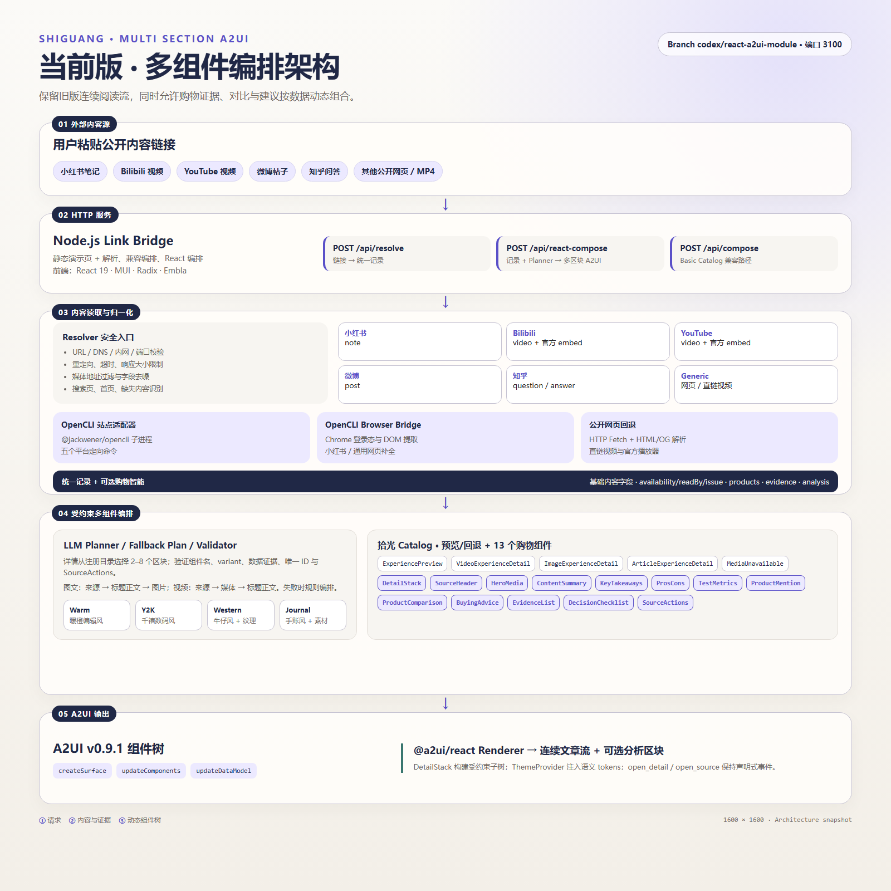

# Link Bridge 新旧版本架构图

## 旧版：单组件详情架构

- 一条统一内容记录选择一个完整详情组件。
- LLM Planner 只能在四个详情组件中选择一个，失败时按内容类型回退。
- 标题、正文、媒体和操作由同一个详情组件统一排版，因此阅读节奏天然连续。

## 当前版：多组件编排架构

- 保留同一套 Resolver、OpenCLI、Browser Bridge 和公开网页回退链路。
- LLM Planner 或规则计划从注册目录选择 2–8 个详情区块，并通过证据与数据可用性校验。
- Catalog 包含 5 个预览/兼容组件和 13 个购物详情组件。
- Theme Registry 提供暖橙、千禧数码、牛仔和手账四套语义主题。

两张 PNG 均为 `1600 × 1600`。对应 HTML 文件可以直接在浏览器打开并继续编辑。
