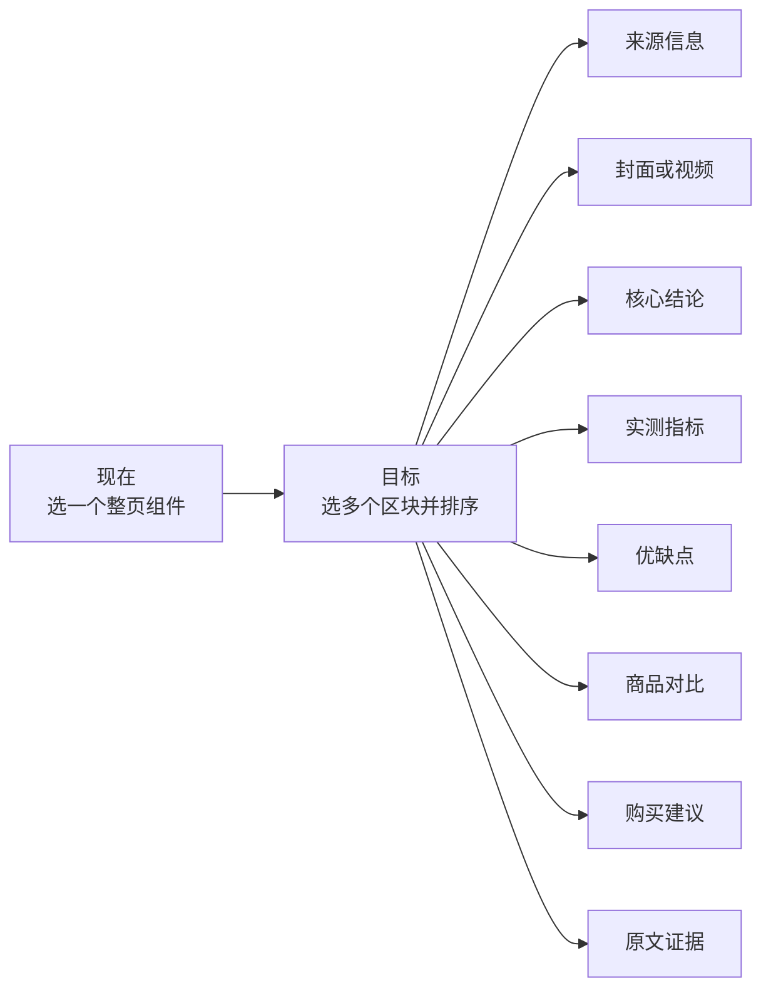
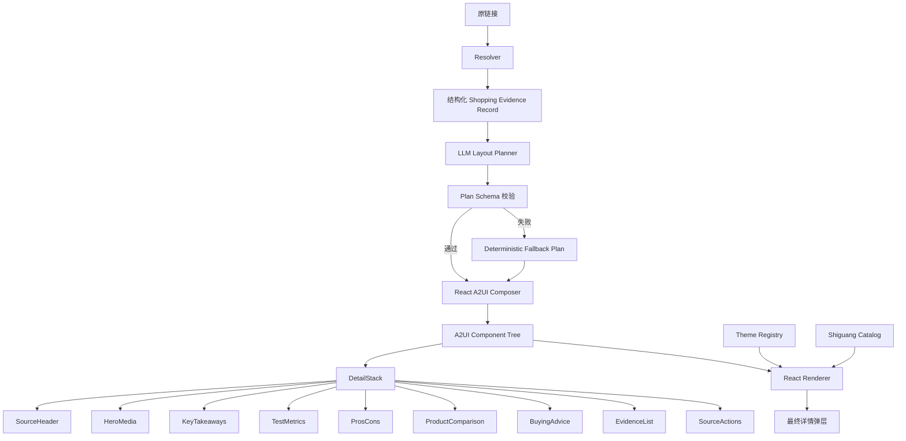

# 拾光 A2UI 下一阶段改造设计报告

> 主题：Theme 系统、购物组件目录与 LLM Planner 多组件编排  
> 用途：直接交接给下一位设计或开发人员  
> 当前分支：`codex/react-a2ui-module`  
> 报告基线提交：`69f7c35`  
> 模块目录：`link-bridge/`

---

## 1. 本次改造目标

当前模块已经具备完整的 A2UI 链路：

```text
真实链接
→ Resolver 统一内容
→ LLM Planner 选择详情组件
→ A2UI v0.9.1 消息
→ React Renderer
→ 拾光 Catalog 组件
→ 详情弹层
```

目前的主要限制是：

1. Planner 每次只能选择一个大型详情组件。
2. Catalog 中的组件主要按“视频、图集、文章”分类，还没有足够的购物决策组件。
3. Theme 直接写在 React 客户端中，只有暖橙和千禧两套基础风格。
4. 主题与组件局部 CSS 还没有严格分层。
5. 当前页面虽然有 A2UI 参与，但不同内容的页面结构差异还不够大。

下一阶段的核心目标是：

> 把“Planner 从几个整页模板中选一个”，升级为“Planner 使用多个购物区块组装一张详情页”。



---

## 2. 范围与不改范围

### 2.1 本次主要修改

- `link-bridge` 内的 React A2UI 模块。
- 拾光 Catalog 的组件数量、Schema 和组件层级。
- Theme Registry、Theme Token 和风格资产。
- LLM Planner 的输入、输出和校验。
- React A2UI Composer 的多组件消息生成。
- 针对组件、Theme 和 Planner 的测试。

### 2.2 本次不修改

- 不把新模块接入 `backend/` 购物智能体。
- 不修改 `wit_agent/`。
- 不改变原有 `POST /api/compose` 的 Lit A2UI 兼容路径。
- 不让 LLM 直接生成 HTML、CSS 或 React 代码。
- 不将 API Key 写入代码、文档或 Git。

---

## 3. 当前代码位置与职责

| 位置 | 当前职责 | 关键位置 |
|---|---|---|
| `link-bridge/src/resolver.mjs` | 链接安全检查、OpenCLI/浏览器/公开页面读取、统一 Record | `resolveLink` 约在 242 行；`contentType` 判断约在 319 行 |
| `link-bridge/src/llm-planner.mjs` | 调用大模型，从允许的详情组件中选一个 | 白名单约在 1 行；Prompt 约在 43 行；校验约在 70 行 |
| `link-bridge/src/react-a2ui.mjs` | 将 Record + Planner 结果转为 A2UI v0.9.1 Messages | `commonData` 约在 37 行；`composeReactA2ui` 约在 58 行 |
| `link-bridge/src/react-catalog/catalog.jsx` | 全部 React A2UI 组件的 Schema、实现和 Catalog 注册 | Schema 约在 22–58 行；组件约在 84–187 行；注册约在 189 行 |
| `link-bridge/src/a2ui-client.jsx` | React 入口、Theme、预览列表、详情弹层和 A2UI Surface | Theme 约在 38 行；Surface 约在 56 行；详情请求约在 86 行 |
| `link-bridge/src/server.mjs` | HTTP API、Resolver 与 Planner 串联、Planner 回退 | `/api/react-compose` 约在 52 行 |
| `link-bridge/public/a2ui.css` | 页面布局、弹层、组件和主题的混合 CSS | 当前主要集中在一个文件 |
| `link-bridge/test/react-a2ui.test.mjs` | Composer 与组件选择测试 | 需扩展多组件树测试 |
| `link-bridge/test/llm-planner.test.mjs` | Planner 白名单、请求与非法组件测试 | 需扩展 Plan Schema 测试 |
| `link-bridge/test/resolver.test.mjs` | 多来源内容解析回归测试 | 保留并新增购物字段测试 |
| `link-bridge/.env` | 本地 LLM 网关参数 | 已被 `.gitignore` 排除，禁止提交 |

### 3.1 当前组件

1. `ExperiencePreview`：列表预览卡。
2. `VideoExperienceDetail`：视频整页详情。
3. `ImageExperienceDetail`：图集整页详情。
4. `ArticleExperienceDetail`：文章整页详情。
5. `MediaUnavailable`：内容不可用的降级界面。

### 3.2 当前 Theme

1. `warm`：暖橙编辑风。
2. `y2k`：千禧数码风。

当前 Theme 直接定义在 `src/a2ui-client.jsx` 的 `themes` 对象中，局部风格又写在 `public/a2ui.css` 中。这会使新增主题时需要同时修改多个位置。

---

## 4. 目标架构



---

## 5. 最优先任务：扩充购物组件目录

## 5.1 组件设计原则

1. 组件按“购物决策任务”划分，不再只按内容来源划分。
2. 一个组件只解决一个明确问题。
3. 组件必须能在 320px 宽度下使用。
4. 组件必须定义缺数据时的降级方式。
5. 组件不直接写主题颜色、主题阴影和主题字体。
6. 组件只接收经校验的数据或 Data Binding，禁止执行模型生成的 HTML。
7. 组件中的外部链接必须来自 Resolver 数据，不能来自 LLM 自由文本。

## 5.2 P0 必做组件

### A. `DetailStack`

作用：多组件详情页的根容器。

建议 Schema：

```js
{
  children: CommonSchemas.ChildList,
  density: z.enum(['comfortable', 'compact']).optional()
}
```

实现要求：

- 使用 `buildChild` 按 Planner 给出的顺序渲染子组件。
- 设置 `allowedChildren`，只允许拾光 Catalog 中的详情区块。
- 区块数量不得超过 8 个。
- 相邻区块的间距来自 Theme spacing Token。

### B. `SourceHeader`

展示：平台、作者、发布时间、互动量、内容类型。

必需字段：`platform`、`title` 或 `author` 至少有一个。

降级：作者缺失的普通网页显示“网页内容”。

### C. `HeroMedia`

展示：可播放视频、视频封面、单图或图片轮播。

`variant`：`video | gallery | image | poster`。

降级顺序：

```text
可播放视频
→ 封面 + 时长
→ 图片轮播
→ 单封面
→ 不渲染该区块
```

### D. `KeyTakeaways`

展示 1–4 条核心结论。

每条建议结构：

```json
{
  "text": "日常通勤容量足够",
  "sentiment": "positive",
  "evidenceId": "evidence-2"
}
```

不允许只有“很好用”这种无信息结论。

### E. `ProsCons`

展示优点和缺点，每侧最多 4 条。

`variant`：`balanced | compact | evidence-first`。

当只有优点而没有缺点时，不能伪造缺点；组件改为单列显示。

### F. `TestMetrics`

展示实测指标，例如充电速度、重量、温度、续航、容量。

每个指标必须有：

```json
{
  "label": "充至80%",
  "value": "30分钟",
  "evidenceId": "evidence-3"
}
```

数值不得由 Planner 猜测，必须来自 Resolver 或被明确标记为“原文表述”。

### G. `ProductMention`

展示内容中提到的单个商品。

字段：名称、型号、图片、与原商品的匹配状态、可选价格。

禁止 Planner 自行生成购买链接。

### H. `ProductComparison`

展示 2–5 款商品的横向对比。

`variant`：`table | cards | compact`。

最多 6 个对比维度，移动端优先卡片或横向滚动，不得把字体压缩到不可读。

### I. `BuyingAdvice`

展示结合用户需求的购买结论。

建议字段：

```json
{
  "verdict": "适合日常通勤",
  "reasons": ["自带线", "重量较低"],
  "notFor": ["需要同时给多台设备充电的用户"],
  "confidence": 0.82
}
```

建议必须能追溯到用户需求与证据。

### J. `EvidenceList`

展示原文证据、视频时间点或数据来源。

示例：

```json
{
  "id": "evidence-3",
  "text": "给 iPhone 充至 80% 约 30 分钟",
  "sourceType": "video-timestamp",
  "locator": "03:21"
}
```

### K. `SourceActions`

统一处理：查看原内容、问拾光、可选的查看商品。

所有 Action 仍使用声明式 A2UI Event，禁止将任意 JavaScript 作为属性传入。

## 5.3 P1 后续组件

- `CompatibilityMatrix`：充电协议、设备、尺寸或系统兼容性。
- `RiskAlert`：安全、退货、发热、虚标等风险。
- `DecisionChecklist`：选购前核对清单。
- `PriceAndOffer`：价格、优惠、保价和退换信息。
- `SpecificationTable`：官方参数。
- `CreatorVerdict`：创作者最终结论。

---

## 6. 最优先任务：Planner 升级为多组件编排

## 6.1 当前输出

当前 `llm-planner.mjs` 只输出：

```json
{
  "component": "ArticleExperienceDetail",
  "reason": "...",
  "confidence": 0.98,
  "displayTitle": "...",
  "displayBody": "...",
  "showCover": false
}
```

## 6.2 目标输出

建议将输出升级为：

```json
{
  "planVersion": "1",
  "reason": "该内容是多商品横向测评，先展示结论和实测，再展示对比与购买建议。",
  "confidence": 0.92,
  "theme": {
    "name": "warm",
    "density": "comfortable"
  },
  "content": {
    "displayTitle": "16款充电宝横向实测",
    "displaySummary": "...",
    "showCover": true
  },
  "sections": [
    { "id": "source", "component": "SourceHeader", "variant": "default" },
    { "id": "hero", "component": "HeroMedia", "variant": "video" },
    { "id": "takeaways", "component": "KeyTakeaways", "variant": "default" },
    { "id": "metrics", "component": "TestMetrics", "variant": "grid" },
    { "id": "comparison", "component": "ProductComparison", "variant": "cards" },
    { "id": "advice", "component": "BuyingAdvice", "variant": "default" },
    { "id": "actions", "component": "SourceActions", "variant": "default" }
  ]
}
```

## 6.3 Planner 强约束

1. `sections` 数量限制为 2–8个。
2. `id` 在当前 Surface 内必须唯一。
3. `component` 必须出自 Catalog 白名单。
4. `variant` 必须出自对应组件的允许集合。
5. Planner 只决定组件和 Data Path，不生成图片 URL、商品 URL 和价格。
6. Planner 不能输出任意 CSS、HTML 或 JavaScript。
7. Planner 不得将没有证据的数值写入 `TestMetrics`。
8. Planner 输出失败时使用确定性 Fallback Plan。

## 6.4 Fallback Plan

### 视频

```text
DetailStack
├─ SourceHeader
├─ HeroMedia(video/poster)
├─ KeyTakeaways（有结论时）
├─ ContentSummary
└─ SourceActions
```

### 图集

```text
DetailStack
├─ SourceHeader
├─ HeroMedia(gallery)
├─ ContentSummary
├─ ProsCons（有结构化数据时）
└─ SourceActions
```

### 文章或普通网页

```text
DetailStack
├─ SourceHeader
├─ ContentSummary
├─ DecisionChecklist（有数据时）
└─ SourceActions
```

### 内容不可用

```text
MediaUnavailable
```

---

## 7. React A2UI Composer 具体改造

修改文件：`src/react-a2ui.mjs`

## 7.1 拆分函数

建议拆成：

```text
normalizeRecord(record)
buildFallbackPlan(record)
validatePlanAgainstRecord(plan, record)
buildPreviewMessages(record)
buildDetailComponentTree(record, plan)
buildDetailMessages(record, plan)
```

## 7.2 生成组件树

不再只生成：

```json
[
  { "id": "root", "component": "VideoExperienceDetail" }
]
```

目标是生成：

```json
[
  {
    "id": "root",
    "component": "DetailStack",
    "children": ["source", "hero", "takeaways", "metrics", "advice", "actions"]
  },
  {
    "id": "source",
    "component": "SourceHeader",
    "platform": { "path": "/source/platform" },
    "author": { "path": "/author" }
  },
  {
    "id": "hero",
    "component": "HeroMedia",
    "variant": "video",
    "cover": { "path": "/cover" },
    "video": { "path": "/video" }
  },
  {
    "id": "takeaways",
    "component": "KeyTakeaways",
    "items": { "path": "/analysis/takeaways" }
  },
  {
    "id": "metrics",
    "component": "TestMetrics",
    "items": { "path": "/analysis/metrics" }
  },
  {
    "id": "advice",
    "component": "BuyingAdvice",
    "value": { "path": "/analysis/buyingAdvice" }
  },
  {
    "id": "actions",
    "component": "SourceActions",
    "sourceUrl": { "path": "/source/url" }
  }
]
```

## 7.3 A2UI ChildList 实现要求

当前已安装的 `@a2ui/web_core/v0_9` 提供 `CommonSchemas.ChildList`，`@a2ui/react/v0_9` 的组件实现可通过 `buildChild` 渲染子节点。

下一位开发者需要：

1. 在 `DetailStack` Schema 中使用 `CommonSchemas.ChildList`。
2. 在 React 实现中将解析后的 child id 交给 `buildChild`。
3. 为 `DetailStack` 定义 `allowedChildren`。
4. 增加一个包含 5 个子区块的真实 A2UI Surface 测试。
5. 测试非法 child id、循环引用与超过区块数量的输入。

---

## 8. Theme 系统改造

## 8.1 当前问题

- Theme 直接写在 `src/a2ui-client.jsx`。
- 主题属性与页面 CSS 混在 `public/a2ui.css`。
- 组件中存在局部硬编码平台颜色。
- 新增风格时容易遗漏弹层、卡片或移动端状态。

## 8.2 目标文件结构

```text
src/theme/
├─ tokens.js
├─ create-shiguang-theme.js
├─ registry.js
├─ warm.js
├─ y2k.js
├─ western.js
└─ journal.js

public/themes/
├─ warm.css
├─ y2k.css
├─ western.css
└─ journal.css

public/assets/themes/
├─ western/
│  ├─ denim-texture.webp
│  ├─ leather-label.webp
│  └─ stitch.svg
└─ journal/
   ├─ paper-texture.webp
   ├─ tape.webp
   └─ stamp.svg
```

## 8.3 Theme Token 最低集合

```js
{
  name: 'western',
  colors: {
    page: '#...',
    surface: '#...',
    surfaceMuted: '#...',
    text: '#...',
    textMuted: '#...',
    primary: '#...',
    onPrimary: '#...',
    positive: '#...',
    warning: '#...',
    negative: '#...',
    evidence: '#...',
    border: '#...'
  },
  typography: {
    displayFamily: '...',
    bodyFamily: '...',
    displayWeight: 700,
    bodyWeight: 400,
    scale: { xs: 12, sm: 14, md: 16, lg: 20, xl: 28 }
  },
  shape: {
    cardRadius: 16,
    sheetRadius: 28,
    buttonRadius: 14,
    chipRadius: 999
  },
  spacing: { section: 24, card: 16, inline: 8 },
  elevation: {
    card: '...',
    sheet: '...',
    floating: '...'
  },
  motion: {
    fast: 160,
    normal: 260,
    easing: 'cubic-bezier(...)'
  },
  assets: {
    pageTexture: '/assets/themes/western/denim-texture.webp',
    labelTexture: '/assets/themes/western/leather-label.webp',
    divider: '/assets/themes/western/stitch.svg'
  }
}
```

## 8.4 Theme 与组件的责任边界

### Theme 负责

- 颜色。
- 字体。
- 字号层级。
- 圆角。
- 间距 Token。
- 边框和阴影。
- 动画 Token。
- 纹理和装饰资产。
- 信息密度。

### 组件负责

- 元素顺序。
- 元素位置。
- 封面比例。
- 标题最大行数。
- 是否左右滑动。
- 是否可播放。
- 按钮执行哪个 Action。
- 缺数据时的结构降级。

## 8.5 牛仔风 `western` 要求

### 视觉语言

- 主色：深牛仔蓝、皮革棕、米白、铆钉银。
- 标题：Slab Serif 或粗衬线字体。
- 正文：保持易读的无衬线字体。
- 容器：小圆角、缝线分割、皮革标签。
- 阴影：较实、较短，避免大面积模糊阴影。
- 装饰：纹理和铆钉只用在局部，不覆盖正文阅读区。

### 实现要求

- 纹理必须使用有授权素材或单独生成的资产。
- 不得用大量 CSS 渐变假装所有材质。
- 需提供 3–5 张风格参考：整体页、卡片、弹层、纹理细节、字体氛围。
- 需要同时测试视频、图集和文章三种内容。

## 8.6 手账风 `journal` 要求

### 视觉语言

- 主色：米白纸张、墨水黑、低饱和贴纸色。
- 标题：手写风字体，仅用于标题和小标签。
- 正文：使用易读黑体。
- 容器：纸张、便签、胶带、撕边、印章。
- 动效：纸张轻微弹出，必须支持 `prefers-reduced-motion`。

### 实现要求

- 贴纸和胶带不能遮挡信息。
- 手写字体不能用于长段正文。
- 同一页的装饰资产数量需有上限。
- 移动端不能依赖横向滚动阅读正文。

---

## 9. Resolver 的支撑性改造

虽然本次主要集中在 Theme 和组件，但新组件需要 Resolver 提供更结构化的数据。

建议在统一 Record 中增加：

```json
{
  "products": [],
  "analysis": {
    "takeaways": [],
    "pros": [],
    "cons": [],
    "metrics": [],
    "suitableFor": [],
    "notFor": [],
    "buyingAdvice": null
  },
  "evidence": []
}
```

实现原则：

1. Resolver 负责可验证的数据和原文位置。
2. LLM 可以归纳优缺点，但必须引用 `evidenceId`。
3. 价格、商品 URL、实测数值不能由 LLM 自由生成。
4. 结构化抽取失败不影响原有标题、正文和封面降级链路。

---

## 10. 建议文件拆分

当前 `src/react-catalog/catalog.jsx` 包含 Schema、所有组件和注册逻辑。扩充后需要拆分：

```text
src/react-catalog/
├─ catalog.jsx
├─ schemas/
│  ├─ common.js
│  ├─ media.js
│  ├─ shopping.js
│  └─ evidence.js
├─ components/
│  ├─ DetailStack.jsx
│  ├─ SourceHeader.jsx
│  ├─ HeroMedia.jsx
│  ├─ KeyTakeaways.jsx
│  ├─ ProsCons.jsx
│  ├─ TestMetrics.jsx
│  ├─ ProductMention.jsx
│  ├─ ProductComparison.jsx
│  ├─ BuyingAdvice.jsx
│  ├─ EvidenceList.jsx
│  └─ SourceActions.jsx
├─ shared/
│  ├─ PlatformChip.jsx
│  ├─ EmptyState.jsx
│  └─ ResponsiveMedia.jsx
└─ index.js
```

CSS 建议拆分：

```text
public/styles/
├─ app.css
├─ dialog.css
├─ preview.css
├─ detail-layout.css
├─ shopping-components.css
└─ responsive.css
```

---

## 11. 分阶段实施计划

## Phase 0：保护当前基线

交付：

- 保留当前 30 个测试全部通过。
- 保留当前单组件 Composer 作为 fallback。
- 记录当前暖橙和千禧主题截图。
- 保留 `http://127.0.0.1:3100/a2ui.html` 作为独立预览入口。

## Phase 1：拆分 Catalog 并新增 P0 组件

交付：

- `DetailStack`、`SourceHeader`、`HeroMedia`、`KeyTakeaways`、`ProsCons`、`TestMetrics`、`ProductMention`、`ProductComparison`、`BuyingAdvice`、`EvidenceList`、`SourceActions`。
- 每个组件的 Zod Schema。
- 每个组件至少一个正常状态和一个缺数据状态测试。
- 一个固定的多组件示例 Surface，先不接 LLM。

验收：

- 固定的充电宝测评数据可同时渲染至少 6 个子区块。
- 所有子区块都是真实 A2UI Component Node，不是一个 React 组件内部手动 `map` 的伪组件数组。

## Phase 2：Planner 多组件编排

交付：

- Planner v1 Plan Schema。
- 组件和 variant 白名单。
- Plan 与 Record 的二次校验。
- 视频、图集、文章、横评四种 Fallback Plan。
- Planner Trace 中显示区块数、选择理由和回退状态。

验收：

- 小红书图文、B 站横评、知乎文章产生明显不同的区块组合。
- 模型输出未知组件时被拒绝。
- LLM 断网、超时或鉴权失败时页面仍可用。

## Phase 3：Theme Registry

交付：

- 将 `warm` 和 `y2k` 迁移到 Theme Registry。
- 新增 `western` 和 `journal`。
- Theme Token 类型与默认值。
- 主题资产目录与授权说明。
- 每个 Theme 的视频、图集、文章、对比页截图。

验收：

- 切换 Theme 不更改 A2UI Component Tree。
- 同一组件树可在四套 Theme 中正常显示。
- 320px、768px、1440px 宽度下没有横向溢出。
- 对比、风险和证据的语义颜色在各 Theme 中都清晰可读。

## Phase 4：Resolver 购物数据与整体回归

交付：

- `products`、`analysis`、`evidence` 字段。
- 至少 3 个来源的真实链接样本。
- 真实内容读取失败的降级用例。
- 一份视觉 QA 报告。

---

## 12. 测试要求

## 12.1 单元测试

- 每个 Schema 拒绝超长数组、错误 variant 和非法 URL。
- `DetailStack` 只接受允许的子组件。
- Planner 不能输出 Catalog 外的组件。
- Composer 生成的所有 child id 都存在。
- Action 仍是声明式 event。
- Theme 缺少 Token 时使用默认值。

## 12.2 集成测试

至少覆盖：

1. 小红书图文体验。
2. B 站单品视频。
3. B 站多商品横评。
4. 知乎文章。
5. 普通技术文档。
6. 电商商品页。
7. 无封面。
8. 无正文。
9. LLM 无法连接。
10. LLM 输出非法 JSON。

## 12.3 视觉回归

每个 Theme 至少保留以下截图：

```text
桌面端预览列表
移动端预览列表
视频详情
图集详情
文章详情
商品对比详情
内容不可用状态
```

---

## 13. 性能与安全要求

- Planner 超时上限继续由 `LLM_TIMEOUT_MS` 控制。
- Planner 结果建议使用内容 Record Hash 做短时缓存，避免重复点击重复调用 LLM。
- 任意外部 URL 都继续使用 Resolver 现有的公网 URL 校验。
- 禁止 Planner 生成或覆盖 `sourceUrl`、商品 URL 和媒体 URL。
- 富文本不得直接使用 `dangerouslySetInnerHTML`。
- 图片数量、商品数量、指标数量和区块数量必须有上限。
- API Key 仅保存在 `link-bridge/.env`，`.env.example` 只保留空值示例。

---

## 14. 最终验收标准

全部满足时才算改造完成：

1. Planner 可输出 2–8 个受约束的子组件。
2. B 站横评、小红书图文和知乎文章的组件组合明显不同。
3. 详情页至少能展示核心结论、优缺点、实测数据、商品对比和购买建议中的三类。
4. 新组件不依赖某一个平台名称才能工作。
5. `warm`、`y2k`、`western`、`journal` 四套 Theme 共用同一组件树。
6. Theme 切换不修改内容数据和组件顺序。
7. 320px、768px和 1440px 下无溢出、遮挡或不可读文字。
8. LLM 失败时使用 Fallback Plan，页面仍可查看原内容。
9. 模型不能调用未注册组件或传入未校验属性。
10. 原有 `npm test` 全部通过，并新增多组件、Theme 和 Fallback 测试。
11. `npm run build:a2ui` 成功。
12. 浏览器 Console 无 error。
13. `.env` 与 API Key 不得进入 Git。
14. 不修改 `backend/` 和 `wit_agent/` 中的现有购物智能体逻辑。

---

## 15. 开发与启动命令

```powershell
cd "C:\Users\kelly\Documents\ChatGPT\购物智能体 2\link-bridge"
npm install
npm test
npm run build:a2ui
npm start
```

预览地址：

```text
http://127.0.0.1:3100/a2ui.html
```

本地 LLM 配置从 `.env.example` 复制，由接手人员自行填写 `.env`。禁止将密钥写入报告或提交记录。

---

## 16. 交接时建议下一位开发者先做的事

1. 运行当前 30 个测试，确认基线。
2. 不接 LLM，先完成 `DetailStack + ChildList + 6 个固定子区块` 的真实 A2UI 组件树。
3. 将组件 Schema 和 React 实现拆分到独立文件。
4. 为多组件 Composer 补齐单元测试。
5. 再升级 Planner 输出 `sections[]`。
6. 在多组件编排稳定之后，再拆分 Theme Registry 并新增牛仔风和手账风。
7. 最后再扩展 Resolver 的购物证据字段。

该顺序的原因是：Theme 需要稳定的组件边界，Planner 需要稳定的 Catalog 才能可靠编排。先设计组件合同，再接入 Planner 和 Theme，可以减少重复返工。

