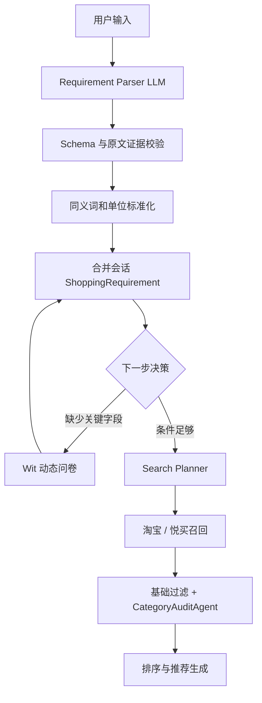

# 购物需求结构化解析与 Wit 问卷改造开发文档

> 日期：2026-11-19
> 项目：拾光购物智能体 2
> 目标：在不为每个品类大量硬编码问卷和解析规则的前提下，提高自然语言输入的容错率，并把结构化需求稳定传递给 Wit 问卷、搜索、品类审核和推荐模块。

> 实施状态（2026-11-20）：阶段一至三已开发并融合到正式 Wit 链路。已新增 `wit_agent/requirement.py`、`wit_agent/data/entity_aliases.json` 和 `wit_agent/tests/test_requirement.py`；公开聊天请求契约保持兼容。维护中的购物回归集 52 项通过。完整 Python 目录仍包含 5 项历史内容/链接检索契约测试，不属于本轮功能且未宣称全绿。

## 0. 当前代码版本与地址

本节记录的是 **2026-11-20 核对时的实际工作区状态**。开发前必须先确认这些信息，避免在历史原型或旧 Node Agent 上修改。

### 0.1 代码位置

| 项目 | 当前值 |
|---|---|
| 本地项目根目录 | `C:\Users\kelly\Documents\ChatGPT\购物智能体 2` |
| Git 远端仓库 | [iamroxy-0604/shopping](https://github.com/iamroxy-0604/shopping.git) |
| 当前本地分支 | `codex/user-memory-auth` |
| 当前提交基线 | `4f9c44e1c12f1e9cbe0d13d2bf4e25400927dd3f` |
| 短提交号 | `4f9c44e` |
| 基线提交说明 | `docs: hand off category audit agent integration` |
| 基线提交时间 | `2026-11-16 13:47:31 +08:00` |
| 当前分支 upstream | 未设置 |
| 对应远端备份分支 | `origin/codex/current-agent-backup-20261116`（同一基线提交） |

仓库的 `backend/package.json` 当前没有语义化 `version` 字段，因此本项目不能用类似 `v1.2.0` 的版本号定位代码。开发和交接时必须同时记录：

```text
Git commit + branch + 工作区是否有未提交修改
```

### 0.2 当前版本边界

当前工作区不是纯净的 `4f9c44e`，而是：

```text
提交基线 4f9c44e
+ 本地尚未提交的用户记忆/账号相关修改
+ 本地尚未提交的 CategoryAuditAgent 及审核修复
+ 本地尚未提交的前后端修改和开发文档
```

与本设计直接相关的当前本地文件状态包括：

```text
M  wit_agent/agent.py
M  wit_agent/llm.py
M  wit_agent/memory.py
M  wit_agent/server.py
?? wit_agent/category_audit.py
?? wit_agent/tests/test_category_audit.py
M  backend/src/server.mjs
M  backend/public/desktop/app.js
```

因此：

- 直接从 GitHub 检出 `4f9c44e`，不能得到当前电脑上的全部功能。
- 本文的改造目标应基于当前本地工作区，而不是只基于远端提交。
- 在交给下一位开发者之前，应先把正式代码整理为独立提交或可审查的分支。
- 不要把大量原型、图片、数据库、日志、`.env` 和无关文档一起提交。

### 0.3 当前正式运行入口

| 层级 | 代码地址 | 作用 |
|---|---|---|
| 桌面前端 | `backend/public/desktop/` | 默认首页和桌面购物 UI |
| 移动前端 | `backend/public/` | 移动端聊天与 SSE UI |
| Node 入口 | `backend/src/server.mjs` | 静态页面、聊天接口、商品搜索接口 |
| 联合启动器 | `backend/src/start-wit.mjs` | 先启动 Python Wit，再启动 Node |
| Wit HTTP 服务 | `wit_agent/server.py` | 本机 Python Sidecar |
| Wit 主智能体 | `wit_agent/agent.py` | `load -> plan -> retrieve -> reply -> save` |
| 输入解析 | `wit_agent/llm.py`、`wit_agent/policy.py` | 当前扁平需求解析；本设计主要改造位置 |
| 会话记忆 | `wit_agent/memory.py` | SQLite 会话状态和共享品类规则 |
| 品类审核 | `wit_agent/category_audit.py` | 搜索规划、负关键词和商品本体审核 |
| 商品源网关 | `backend/src/product-source.mjs` | 淘宝、悦买商品源适配 |

以下目录是历史原型或设计实验，不是本设计的正式落点：

```text
desktop-shopping-prototype/
frontend-redesign-prototype/
prototype-content-cards/
prototype-yuemai/
shiguang-flow-prototype/
multimodal-demo/
```

### 0.4 启动命令与服务地址

当前正式 Wit 版本应使用：

```powershell
cd "C:\Users\kelly\Documents\ChatGPT\购物智能体 2\backend"
npm run start:wit
```

启动后地址：

| 服务 | 地址 |
|---|---|
| 桌面前端 | `http://127.0.0.1:3000/` |
| 移动前端 | `http://127.0.0.1:3000/mobile/` |
| Node 健康检查 | `http://127.0.0.1:3000/health` |
| Python Wit 健康检查 | `http://127.0.0.1:8765/health` |
| 桌面聊天接口 | `POST http://127.0.0.1:3000/api/desktop/chat` |
| 普通聊天接口 | `POST http://127.0.0.1:3000/api/chat` |
| SSE 聊天接口 | `POST http://127.0.0.1:3000/api/chat/stream` |
| 商品搜索接口 | `POST http://127.0.0.1:3000/api/products/search` |
| Node 到 Wit 内部接口 | `POST http://127.0.0.1:8765/internal/wit/chat` |

截至 2026-11-20 本次文档核对时，`3000` 和 `8765` 均未监听，说明服务当前未启动；以上是启动后的固定本机地址，不代表当前正在运行。

健康检查成功时，Node 应返回类似：

```json
{
  "ok": true,
  "service": "taobao-search",
  "agentRuntime": "wit3"
}
```

如果 `agentRuntime` 不是 `wit3`，不要继续做本设计的联调。

注意：

- `npm run start:wit` / `npm run start:desktop` 才是当前 Wit 主智能体链路。
- `npm start` 只启动 Node 服务，可能进入旧 Agent/兼容链路，不应作为本设计的验收入口。

### 0.5 数据和配置地址

| 内容 | 默认地址 |
|---|---|
| 本地环境变量 | `backend/.env` |
| 环境变量模板 | `backend/.env.example` |
| SQLite 记忆 | `wit_agent/data/memory.sqlite3` |
| 品类审核日志 | `wit_agent/data/category-audit.events.jsonl` |
| 问卷日志 | `wit_agent/data/questionnaire.events.jsonl` |
| Node 日志 | `backend/logs/app.log` |

真实密钥只允许存在于 `backend/.env` 或进程环境变量，不能写入本文档、前端或 Git。

### 0.6 开发前版本确认命令

```powershell
cd "C:\Users\kelly\Documents\ChatGPT\购物智能体 2"
git branch --show-current
git rev-parse HEAD
git status --short
git remote -v
```

期望至少确认：

```text
branch: codex/user-memory-auth
base commit: 4f9c44e
remote: https://github.com/iamroxy-0604/shopping.git
working tree: 存在未提交修改
```

## 1. 背景与问题

当前链路已经使用 LLM 解析用户意图，但解析结果仍然是较扁平的：

```json
{
  "category": "...",
  "style": "...",
  "material": "...",
  "scene": "...",
  "maxPrice": 500
}
```

这会产生三个问题：

1. 品牌、品类和修饰词容易被合并，例如把“苏泊尔的电饭锅”整体识别为品类。
2. 本地 `extract_updates()` 的宽泛正则可能覆盖 LLM 的正确解析。
3. 问卷与搜索没有统一字段契约，问到的答案不一定能改变搜索、过滤或排序。

典型失败链路：

```text
用户：我想买苏泊尔的电饭锅
  ↓
错误 category = 苏泊尔的电饭锅
  ↓
搜索和基础过滤要求商品标题包含完整字符串
  ↓
“苏泊尔电饭煲”被判为品类不匹配
```

本次改造的核心不是增加“苏泊尔”或“电饭锅”的专用规则，而是建立通用的结构化需求理解层。

## 2. 设计原则

### 2.1 通用字段优先

第一版固定支持六类核心商品字段：

- 品类 `category`
- 品牌 `brand`
- 颜色 `color`
- 尺寸 `size`
- 价格 `price`
- 材质 `material`

除此之外使用开放字段 `otherAttributes`，避免为每个品类修改主 Schema：

```json
{
  "otherAttributes": {
    "capacity": "5L",
    "peopleCount": "5人以上",
    "heatingMethod": "IH"
  }
}
```

### 2.2 LLM 负责理解，程序负责约束

- LLM：识别实体角色、上下文、省略表达、否定条件和修改意图。
- 程序：校验 JSON、数字、枚举、原文证据、同义词映射和会话状态。
- LLM 输出不能直接成为硬过滤条件，必须经过验证。
- 本地正则用于高确定性校验和兜底，不能无条件覆盖 LLM。

OpenAI 官方的 Structured Outputs 和 Function Calling 也是这一模式：模型输出受 Schema 约束的数据或工具参数，应用再执行实际业务逻辑。结构正确不代表语义一定正确，因此仍需证据校验和业务验证：

- [OpenAI Structured Outputs](https://developers.openai.com/api/docs/guides/structured-outputs)
- [OpenAI Function Calling](https://developers.openai.com/api/docs/guides/function-calling)

### 2.3 容错优先，不做过早严格过滤

- 不确定的属性进入软偏好，不作为硬过滤。
- 只有用户明确表达、且商品源能够可靠核验的字段才能成为硬条件。
- 先保证召回，再通过审核与排序提升精度。
- 搜索词至少包含一条宽泛兜底查询。

### 2.4 问卷必须有下游用途

每道问题至少影响一项：

- `query`：改变搜索词；
- `filter`：过滤候选；
- `ranking`：改变排序。

无法影响以上任何步骤的问题不应询问。

Google 的对话式商品过滤也是“一个问题对应一个商品属性，回答后立即应用过滤，再决定下一题”，而不是固定对每个品类询问相同四题：

- [Google Conversational Product Filtering](https://docs.cloud.google.com/gemini-enterprise-cx/ai-commerce-search/conversational-filtering?hl=en)
- [Google 商品属性设计](https://docs.cloud.google.com/gemini-enterprise-cx/ai-commerce-search/attribute-config)
- [Google 搜索过滤与排序](https://docs.cloud.google.com/gemini-enterprise-cx/ai-commerce-search/filter-and-order)

## 3. 目标架构



现有 Wit 工作流仍保持：

```text
load -> plan -> retrieve -> reply -> save
```

但 `plan` 内部改为：

```text
解析本轮输入
  -> 标准化
  -> 合并 ShoppingRequirement
  -> 判断是否追问
  -> 生成搜索计划
```

## 4. ShoppingRequirement 数据契约

建议新增 `wit_agent/requirement.py`，集中定义、验证和合并需求对象。

### 4.1 完整结构

```json
{
  "schemaVersion": 1,
  "intent": "search_product",
  "rawText": "想买一个500元以内、5个人用的苏泊尔电饭锅，不要黑色",
  "category": {
    "raw": "电饭锅",
    "canonical": "电饭锅",
    "aliases": ["电饭锅", "电饭煲", "饭煲"],
    "confidence": 0.98,
    "source": "explicit",
    "evidence": "电饭锅"
  },
  "brands": {
    "include": [
      {
        "raw": "苏泊尔",
        "canonical": "苏泊尔",
        "confidence": 0.99,
        "source": "explicit",
        "evidence": "苏泊尔"
      }
    ],
    "exclude": []
  },
  "colors": {
    "include": [],
    "exclude": [
      {
        "raw": "黑色",
        "canonical": "黑色",
        "confidence": 0.99,
        "source": "explicit",
        "evidence": "不要黑色"
      }
    ]
  },
  "sizes": [],
  "price": {
    "min": null,
    "max": 500,
    "currency": "CNY",
    "hard": true,
    "confidence": 1.0,
    "source": "explicit",
    "evidence": "500元以内"
  },
  "materials": {
    "include": [],
    "exclude": []
  },
  "otherAttributes": {
    "peopleCount": {
      "raw": "5个人用",
      "normalized": 5,
      "unit": "person",
      "hard": false,
      "confidence": 0.95,
      "source": "explicit",
      "evidence": "5个人用"
    },
    "capacityLiters": {
      "raw": null,
      "normalized": {
        "min": 4,
        "max": 6
      },
      "unit": "L",
      "hard": false,
      "confidence": 0.7,
      "source": "derived",
      "evidence": null
    }
  },
  "scenes": [],
  "freeTextRequirements": [],
  "hardConstraints": [
    "brand.include=苏泊尔",
    "price.max=500",
    "color.exclude=黑色"
  ],
  "softPreferences": [
    "capacityLiters=4-6L"
  ],
  "missingImportantFields": [],
  "nextAction": "search",
  "parseWarnings": []
}
```

### 4.2 字段统一格式

所有文本实体至少包含：

```json
{
  "raw": "用户原话",
  "canonical": "标准值",
  "confidence": 0.95,
  "source": "explicit",
  "evidence": "原文中的连续证据"
}
```

`source` 只能是：

- `explicit`：用户明确说出；
- `derived`：由明确字段推导；
- `remembered`：来自本会话之前的明确输入；
- `unknown`：无法确认。

只有 `explicit` 且通过证据校验的字段，默认允许成为硬条件。

### 4.3 硬条件和软偏好

硬条件示例：

- “500 元以内”；
- “只要苏泊尔”；
- “不要黑色”；
- “必须是实木”。

软偏好示例：

- “最好轻一点”；
- “偏简约”；
- “五个人用”推导出的 4–6L；
- “看起来高级”。

软偏好只能改变搜索词或排序，不能因为商品资料没有写明就直接拒绝。

## 5. 同义词设计

### 5.1 同义词不应只由 LLM 临时决定

LLM 可以提出候选标准值，但最终映射必须由受控 Resolver 决定：

```text
LLM 提取 raw entity
  -> Alias Resolver 查询
  -> 命中则返回 canonical + aliases
  -> 未命中则保留 raw，标记 unresolved
```

### 5.2 建议的同义词数据结构

第一阶段可使用版本化 JSON；稳定后迁移到 SQLite。

```json
{
  "category": {
    "电饭锅": ["电饭锅", "电饭煲", "饭煲"],
    "充电宝": ["充电宝", "移动电源"],
    "台灯": ["台灯", "桌面灯", "书桌灯"]
  },
  "brand": {
    "苏泊尔": ["苏泊尔", "SUPOR", "supor"],
    "美的": ["美的", "Midea", "midea"]
  },
  "color": {
    "米白色": ["米白", "米白色", "奶油白"],
    "黑色": ["黑", "黑色", "曜石黑"]
  },
  "material": {
    "不锈钢": ["不锈钢", "304不锈钢", "316L不锈钢"]
  }
}
```

注意：`304不锈钢` 与 `316L不锈钢` 在精确材质要求下不能互相替代。Alias Resolver 应支持：

- `equivalent`：完全等价；
- `parent_child`：上下位关系；
- `related`：相关但不能直接替换。

建议正式结构：

```json
{
  "entityType": "material",
  "canonical": "不锈钢",
  "alias": "316L不锈钢",
  "relation": "parent_child",
  "locale": "zh-CN",
  "status": "approved",
  "source": "manual",
  "confidence": 1.0
}
```

### 5.3 防止错误替换

- “苹果手机”中的苹果是品牌。
- “苹果手机壳”中的苹果是适配品牌，主品类是手机壳。
- “配裙子的鞋”主品类是鞋，裙子是搭配对象。
- “苏泊尔电饭锅配件”主品类可能是配件，不是电饭锅本体。

因此同义词解析必须结合实体角色，不能只做字符串替换。

## 6. LLM 输入解析 Prompt

### 6.1 系统提示词草案

```text
你是购物需求语义解析器，不负责推荐商品，也不生成搜索结果。

任务：根据用户本轮输入、当前会话需求和当前商品上下文，输出结构化购物需求增量。

必须区分：
- 商品品类 category
- 品牌 brand
- 颜色 color
- 尺寸 size
- 价格 price
- 材质 material
- 使用场景 scene
- 其他可购买属性 otherAttributes
- 明确排除项 exclusions

规则：
1. 不得把品牌、品类和属性合并成一个 category。
2. category 只表示用户真正要买的商品本体。
3. 每个明确字段必须附带用户原文中的 evidence。
4. 用户未说出的条件不要补充。
5. 常识推导只能标记为 derived 和 soft，不能标记为 hard。
6. “不要、排除、不喜欢”必须进入 exclude，不得进入 include。
7. 如果用户正在询问上一轮商品，intent 应为 compare_current 或 current_detail，
   不得创建新购物任务。
8. 如果用户修改条件，只输出本轮 changes，不要丢失未被修改的旧条件。
9. 不确定时保留 raw 并降低 confidence，不要猜测 canonical。
10. 只输出符合 Schema 的 JSON。
```

### 6.2 输入 Payload

```json
{
  "message": "换成美的吧，还是500以内，白色最好",
  "currentRequirement": {},
  "hasCurrentProducts": true,
  "sourceCapabilities": {
    "price": "filterable",
    "brand": "searchable",
    "color": "title_or_attribute",
    "size": "title_or_attribute",
    "material": "title_or_attribute"
  }
}
```

### 6.3 输出应为增量而不是整份状态

```json
{
  "intent": "refine_search",
  "changes": {
    "brands": {
      "replaceInclude": [
        {
          "raw": "美的",
          "confidence": 0.99,
          "source": "explicit",
          "evidence": "换成美的"
        }
      ]
    },
    "colors": {
      "addInclude": [
        {
          "raw": "白色",
          "confidence": 0.95,
          "source": "explicit",
          "evidence": "白色最好",
          "hard": false
        }
      ]
    }
  }
}
```

价格没有在 `changes` 中重新出现时，保留当前会话的 500 元上限。

## 7. 程序验证规则

### 7.1 Evidence Gate

对于 `explicit` 字段：

```python
evidence in raw_text
```

不成立则：

- 丢弃该字段；
- 写入 `parseWarnings`；
- 不进入硬条件。

### 7.2 数字和单位

程序负责解析：

- `500以内` → `price.max = 500`
- `三百到五百` → `price.min = 300, max = 500`
- `5L` / `五升` → `5 L`
- `1.2米` / `120cm` → 统一基础单位

LLM 负责识别字段角色，程序负责数值合法性和单位换算。

### 7.3 冲突处理

优先级：

```text
本轮 explicit > 本会话 remembered > derived > unknown
```

同一轮冲突时：

- 明确修改词“换成、改成、不要之前的”允许覆盖；
- 否则保留冲突并追问一次；
- 禁止静默选择其中一个。

## 8. Wit 问卷改造

### 8.1 当前问题

当前 `questionnaire_plan()` 让 LLM自由生成三道问题，随后程序按顺序强行赋予：

```text
use / scene / priority
```

问题文本与字段可能不一致，也可能在已知品类后再次询问品类。

### 8.2 新问卷契约

```json
{
  "id": "q_capacity_1",
  "field": "otherAttributes.capacityLiters",
  "title": "家里通常几个人吃饭？",
  "options": [
    {
      "label": "1–2人",
      "value": {
        "min": 1.5,
        "max": 2.5
      }
    },
    {
      "label": "3–4人",
      "value": {
        "min": 3,
        "max": 4
      }
    },
    {
      "label": "5人以上",
      "value": {
        "min": 4,
        "max": 6
      }
    }
  ],
  "affects": ["query", "ranking"],
  "hard": false,
  "reason": "容量会明显缩小候选范围",
  "confidence": 0.9
}
```

### 8.3 不按品类写死，但需要能力约束

主 Schema 不随品类变化，但问题必须来自以下候选：

1. 当前需求中缺失的字段；
2. 商品源能够搜索、过滤或排序的字段；
3. 对当前候选有区分度的字段。

建议统一候选字段池：

```text
category, brand, color, size, price, material, otherAttributes.*
```

LLM 可以提出 `otherAttributes.capacity` 等开放属性，但程序必须检查：

- 是否已经问过；
- 是否与已知字段重复；
- 是否提供 `affects`；
- 是否能映射到搜索或排序；
- 是否包含安全且可区分的选项。

若不能验证，丢弃该问题。

### 8.4 问题数量策略

- 每次只问一题。
- 最多连续追问 3 题。
- 用户条件已经足够时直接搜索。
- 搜索结果 3–20 件时优先展示，不强制继续追问。
- 结果过多时问区分度最高的问题。
- 结果为 0 时先放宽软条件，不立即增加更多问题。

### 8.5 问卷答案合并

答案不再只保存为：

```json
{"id": "priority", "value": "容量大小"}
```

而是转为标准需求增量：

```json
{
  "field": "otherAttributes.capacityLiters",
  "operation": "set",
  "value": {"min": 4, "max": 6},
  "source": "explicit",
  "hard": false,
  "evidence": "5人以上"
}
```

然后调用与自然语言输入相同的 `merge_requirement()`。

## 9. 搜索计划改造

### 9.1 SearchPlan 契约

```json
{
  "queries": [
    "苏泊尔 5L 电饭煲",
    "苏泊尔 大容量 电饭锅",
    "苏泊尔 电饭煲"
  ],
  "sourceFilters": {
    "taobao": {
      "end_price": 500
    },
    "yuemai": {
      "end_price": 500
    }
  },
  "requiredEvidence": {
    "categoryAny": ["电饭锅", "电饭煲", "饭煲"],
    "brandAny": ["苏泊尔", "SUPOR"]
  },
  "softRanking": [
    {
      "field": "capacityLiters",
      "preferredRange": [4, 6],
      "weight": 2
    }
  ],
  "fallbackQueries": [
    "苏泊尔 电饭煲",
    "电饭煲"
  ]
}
```

### 9.2 字段如何进入搜索

| 字段 | Query | API Filter | 返回后校验 | Ranking |
|---|---:|---:|---:|---:|
| 品类 | 必须 | 可选 | 必须 | 是 |
| 品牌 | 通常加入 | 有字段则使用 | 有证据时校验 | 是 |
| 颜色 | 可加入 | 有字段则使用 | 资料缺失不硬拒绝 | 是 |
| 尺寸 | 可加入 | 有字段则使用 | 数值可解析时校验 | 是 |
| 价格 | 不必拼接 | 优先 | 必须二次校验 | 可排序 |
| 材质 | 可加入 | 有字段则使用 | 资料缺失不硬拒绝 | 是 |

Google Commerce Search 同样区分 searchable、indexable/filterable、retrievable 和 ordering，不应把全部属性拼成一个长查询：[Google 属性行为说明](https://docs.cloud.google.com/gemini-enterprise-cx/ai-commerce-search/attribute-config)。

### 9.3 容错与降级

按以下顺序搜索：

1. 品类 + 品牌 + 高价值属性；
2. 品类 + 品牌；
3. 品类同义词；
4. 仅品类宽搜。

不得让“场景、用途、主观要求”挤掉核心品类和品牌。

## 10. 与 CategoryAuditAgent 的接口

CategoryAuditAgent 不再接收自由字符串复合品类：

```json
{
  "targetCategory": {
    "canonical": "电饭锅",
    "aliases": ["电饭锅", "电饭煲", "饭煲"]
  },
  "requiredBrands": ["苏泊尔"],
  "excludeTerms": []
}
```

职责边界：

- Requirement Parser：用户想买什么；
- Search Planner：如何召回；
- 基础过滤：价格、明确品牌、明确排除条件；
- CategoryAuditAgent：候选主要售卖对象是否属于目标品类；
- Ranker：软偏好匹配程度。

品类审核不能负责修复上游“品牌和品类合并”的错误。

## 11. 会话记忆改造

在 `wit_agent/memory.py::_session_default()` 新增：

```json
{
  "shopping_requirement": null,
  "requirement_schema_version": 1,
  "asked_fields": [],
  "last_search_plan": null
}
```

旧字段暂时保留：

- `preferences`
- `shopping_category`
- `shopping_answers`

过渡期由 Adapter 从 `shopping_requirement` 派生旧字段，避免一次修改所有前端和推荐代码。

新会话必须创建独立需求对象；用户明确更换品类时清空商品级属性，但可保留用户明确要求长期记住的个人偏好。

## 12. 现有文件改造清单

### 12.1 新增

#### `wit_agent/requirement.py`

建议函数：

```python
validate_requirement_delta(raw, text) -> dict
normalize_requirement(delta, alias_resolver) -> dict
merge_requirement(current, delta) -> dict
derive_legacy_preferences(requirement) -> dict
question_candidates(requirement, capabilities) -> list[dict]
```

#### `wit_agent/data/entity_aliases.json`

保存受控同义词、上下位关系和版本号。

### 12.2 修改 `wit_agent/llm.py`

- 将 `interpret()` 升级为 `parse_requirement_delta()`。
- 输出 brand/color/size/price/material 和 `otherAttributes`。
- 保留原文 evidence。
- 使用严格 Schema 校验。
- `questionnaire_plan()` 输入完整 `ShoppingRequirement` 和商品源能力。
- 问题输出 `field/affects/options`，不再强行赋予 `use/scene/priority`。
- `search_plan()` 输入结构化需求，而不是扁平 `preferences`。

### 12.3 修改 `wit_agent/policy.py`

当前代码：

```python
updates = {**model_parse.get("query", {}), **extract_updates(text)}
```

会让本地规则覆盖 LLM。改为：

```python
delta = validate_requirement_delta(model_parse, text)
fallback = extract_high_confidence_fallbacks(text)
delta = merge_fallback_without_overwriting_valid_entities(delta, fallback)
```

本地规则只建议保留：

- 明确数字价格；
- 明确否定词；
- 当前商品引用；
- 忘记/修改指令；
- LLM 失败时的有限兜底。

删除“把购买动词后 1–24 字全部当作品类”的宽泛规则。

### 12.4 修改 `wit_agent/agent.py`

`_plan`：

1. 读取当前 `shopping_requirement`；
2. 解析本轮增量；
3. 标准化并合并；
4. 判断新任务/修改/追问/搜索；
5. 生成一个可执行问题或进入检索。

`_retrieve`：

- 使用 SearchPlan；
- 分离 query/filter/ranking；
- 将 canonical category 和 aliases 传给审核智能体。

`_save`：

- 保存 `shopping_requirement`；
- 保存 `asked_fields` 和 `last_search_plan`；
- 继续派生旧 `preferences` 供前端兼容。

### 12.5 修改 `wit_agent/category_audit.py`

- 支持结构化 `targetCategory`；
- 使用上游 aliases；
- 不再依赖有限的本地 `SEARCH_ALIASES` 作为唯一来源；
- 品牌校验不属于品类负关键词。

### 12.6 修改前端问卷契约

第一阶段可以保持前端只显示字符串选项，但后端应保留结构化映射：

```json
{
  "id": "q_capacity_1",
  "field": "otherAttributes.capacityLiters",
  "title": "家里通常几个人吃饭？",
  "options": ["1–2人", "3–4人", "5人以上"],
  "step": 1,
  "total": 2
}
```

前端回传仍可使用：

```json
{
  "questionId": "q_capacity_1",
  "value": "5人以上"
}
```

后端依据保存的 QuestionPlan 转为标准需求增量，不相信客户端传入的字段映射。

## 13. 商品源能力表

为了避免问出无法执行的问题，新增统一能力描述：

```json
{
  "taobao": {
    "category": ["query", "post_filter"],
    "brand": ["query", "post_filter"],
    "color": ["query", "ranking"],
    "size": ["query", "ranking"],
    "price": ["api_filter", "post_filter", "ranking"],
    "material": ["query", "ranking"]
  },
  "yuemai": {
    "category": ["query", "post_filter"],
    "brand": ["query", "post_filter"],
    "color": ["query", "ranking"],
    "size": ["query", "ranking"],
    "price": ["api_filter", "post_filter", "ranking"],
    "material": ["query", "ranking"]
  }
}
```

能力表描述“系统能如何使用字段”，不是声明商品一定提供该字段。

## 14. API 兼容策略

第一阶段不修改公开 `/api/chat` 请求格式。

Python 内部响应增加可选调试字段：

```json
{
  "requirementDebug": {
    "category": "电饭锅",
    "brands": ["苏泊尔"],
    "price": {"max": 500},
    "nextAction": "search"
  }
}
```

生产前端默认不展示；仅开发环境或日志记录，且不能包含用户敏感信息。

## 15. 日志设计

新增事件：

### `requirement_parsed`

```json
{
  "event": "requirement_parsed",
  "sessionId": "...",
  "intent": "search_product",
  "fields": ["category", "brand", "price"],
  "warningCount": 0
}
```

### `requirement_normalized`

```json
{
  "event": "requirement_normalized",
  "category": "电饭锅",
  "aliasCount": 3,
  "brandCount": 1,
  "hardConstraintCount": 2,
  "softPreferenceCount": 1
}
```

### `question_selected`

```json
{
  "event": "question_selected",
  "field": "size",
  "affects": ["query", "ranking"],
  "reason": "missing_high_value_field"
}
```

### `search_plan_created`

记录查询数量、过滤字段和降级级别，不记录密钥或完整个人信息。

## 16. 测试用例

### 16.1 实体拆分

| 输入 | 预期品类 | 预期品牌/适配品牌 |
|---|---|---|
| 苏泊尔电饭锅 | 电饭锅 | 苏泊尔 |
| 美的空气炸锅 | 空气炸锅 | 美的 |
| 苹果手机 | 手机 | 苹果 |
| 苹果手机壳 | 手机壳 | 适配苹果 |
| 配裙子的鞋 | 鞋 | 无品牌；搭配对象=裙子 |
| 小米充电宝保护套 | 保护套 | 适配小米/充电宝 |

### 16.2 价格

| 输入 | 预期 |
|---|---|
| 500以内 | max=500, hard=true |
| 三百到五百 | min=300, max=500 |
| 便宜一点 | intent=refine；根据当前商品推导软上限 |
| 价格无所谓 | 清除本轮临时价格限制 |

### 16.3 否定和修改

| 输入 | 预期 |
|---|---|
| 不要黑色 | colors.exclude=黑色 |
| 不要小米，换成华为 | brand.exclude=小米，include=华为 |
| 还是500以内 | 保留当前品类和品牌，更新/确认 maxPrice |
| 换成空气炸锅 | 新品类任务，清除旧商品属性 |

### 16.4 问卷

- 已知品类后不得再次询问品类。
- 已经明确预算后不得再次询问预算。
- 问题必须有 `field` 和非空 `affects`。
- 同一字段在同一会话不得重复询问。
- 回答后必须改变 Requirement 或被明确拒绝，不能静默丢失。

### 16.5 搜索容错

- 精确查询为 0 时必须执行宽泛查询。
- 软属性不匹配不能让全部候选清零。
- 标题使用品类同义词时能够通过基础过滤。
- 品牌和品类不能被拼成一个 exact category。

## 17. 验收标准

### 功能验收

- “苏泊尔电饭锅”解析为品牌与品类两个字段。
- “500以内的白色苏泊尔电饭锅”能够同时保留品牌、颜色和价格。
- “换成美的”只替换品牌，不清除价格和品类。
- 问卷不重复询问已知字段。
- 每道题能够追踪到 query/filter/ranking 中至少一项。
- CategoryAuditAgent 接收到 canonical category 和 aliases。

### 质量指标

- 品类解析准确率；
- 品牌解析准确率；
- 硬条件错误添加率；
- 问卷重复率；
- 问卷答案实际使用率；
- 零结果率；
- 品类误杀率；
- 精确查询失败后的兜底召回率。

建议建立不少于 100 条中文购物表达的固定回归集，覆盖品牌歧义、否定、修改、口语、省略、同义词、单位和商品追问。

## 18. 分阶段开发计划

### 阶段一：结构化解析

1. 新增 `ShoppingRequirement` Schema。
2. 扩展 `interpret()` 输出六类核心字段和 evidence。
3. 增加 Alias Resolver。
4. 修复本地正则覆盖 LLM 的问题。
5. 保持现有问卷和搜索接口兼容。

### 阶段二：Wit 问卷

1. 问题增加 `field/affects`。
2. 每次只问一个缺失高价值字段。
3. 防止重复提问和重复品类询问。
4. 问卷答案统一写回 `ShoppingRequirement`。

### 阶段三：搜索与审核

1. SearchPlan 分离 query/filter/ranking。
2. 支持同义词与宽泛兜底查询。
3. CategoryAuditAgent 使用 canonical category + aliases。
4. 增加 Requirement、SearchPlan 和审核全链路日志。

### 阶段四：评测与灰度

1. 跑固定回归集。
2. 对比旧链路和新链路的零结果率及误杀率。
3. 使用环境变量控制新解析器灰度：

```env
WIT_REQUIREMENT_SCHEMA_V1=true
```

4. 稳定后移除旧扁平解析路径。

## 19. 最终建议

不建议按照每个品类维护一套完全不同的输入 Schema。主 Schema 应保持通用：品类、品牌、颜色、尺寸、价格、材质，加开放属性。

但也不能完全忽略品类差异：问题是否有价值、属性如何映射搜索，必须结合商品源实际能提供的字段。正确边界是：

```text
通用 Schema
+ LLM 语义理解
+ 受控同义词 Resolver
+ 商品源能力表
+ 动态问题价值判断
```

这比“每个品类写死四道问题”容错更高，也比“全部交给 LLM 自由发挥”更稳定。
